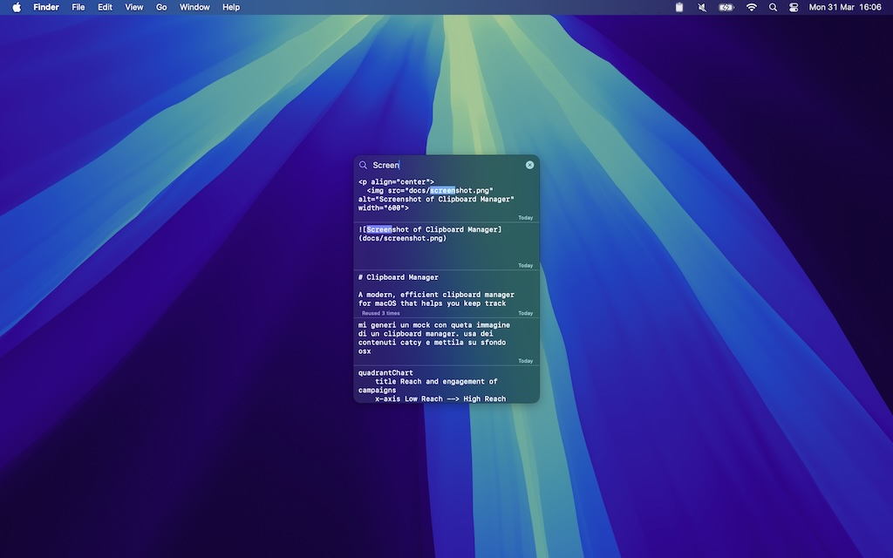

# Clipboard Manager

A modern, efficient clipboard manager for macOS that helps you keep track of your clipboard history and easily access previously copied items.



## 📥 Download

Download the latest version of the app here:

[📦 Download ClipboardManager v1.0.0](https://github.com/nardellil/clipboard-manager/releases/download/v1.0.0/clipboard-manager.zip)

## Features

- 🔄 Automatic clipboard monitoring
- 📋 Persistent clipboard history
- ⌨️ Global hotkey support
- 🖥️ Floating window interface
- 🎯 System tray integration
- ⚡ Fast and lightweight

## Requirements

- macOS 15.2 or later
- Xcode 13.0 or later (for development)
- Swift 5.5 or later

## Installation

1. Clone the repository:
```bash
git clone https://github.com/yourusername/clipboard-manager.git
```

2. Open the project in Xcode:
```bash
cd clipboard-manager
open clipboard-manager.xcodeproj
```

3. Build and run the project (⌘R)

## Usage

1. The app runs in the background and appears as an icon in your menu bar
2. Click the clipboard icon in the menu bar or use the global hotkey to show the clipboard history
3. Click on any item in the history to copy it back to your clipboard
4. Use ⌘V to paste the selected item

## Project Structure

```
clipboard-manager/
├── Models/         # Data models
├── Views/          # SwiftUI views
├── Services/       # Core services (Clipboard, Database, HotKeys)
├── Utils/          # Utility functions
└── Assets.xcassets # Application assets
```

## Development

The project is built using SwiftUI and follows modern Swift development practices. Key components include:

- `ClipboardService`: Monitors clipboard changes and manages clipboard operations
- `DBService`: Handles persistent storage of clipboard history
- `HotKeysService`: Manages global keyboard shortcuts
- `AppDelegate`: Handles application lifecycle and window management

## Contributing

Contributions are welcome! Please feel free to submit a Pull Request.

## License

This project is licensed under the MIT License - see the LICENSE file for details.

## Author

Luca Nardelli 
